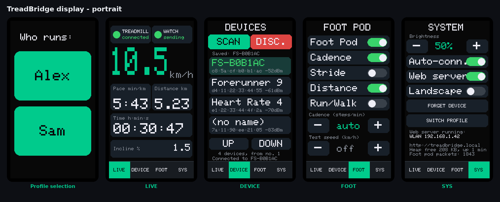
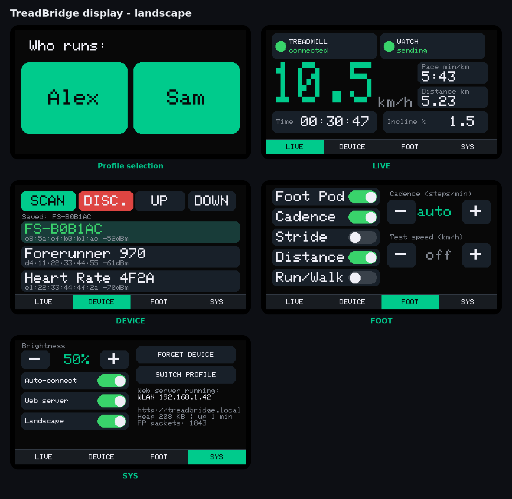
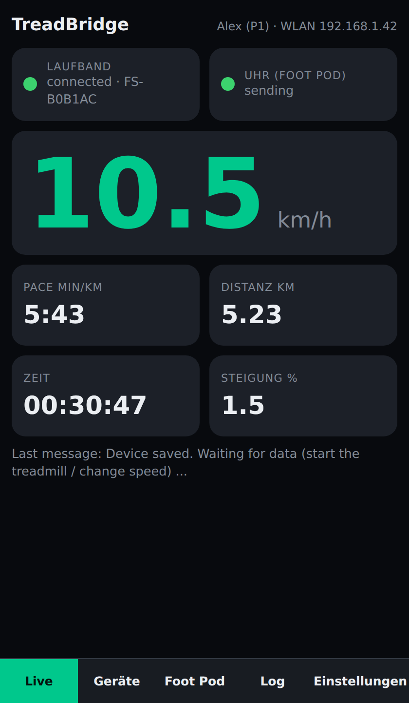
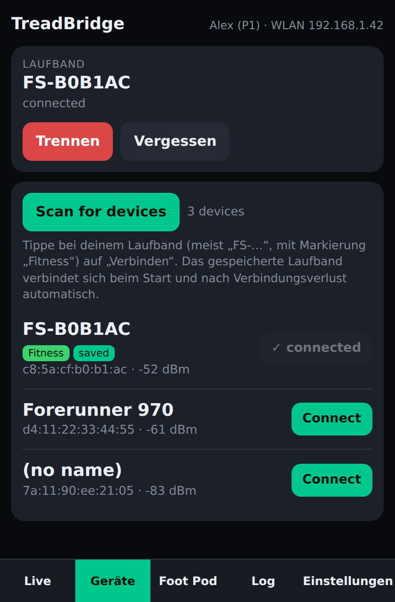
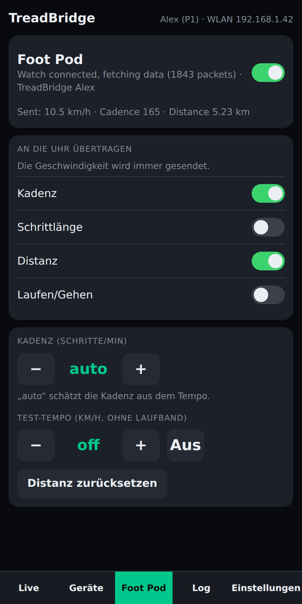
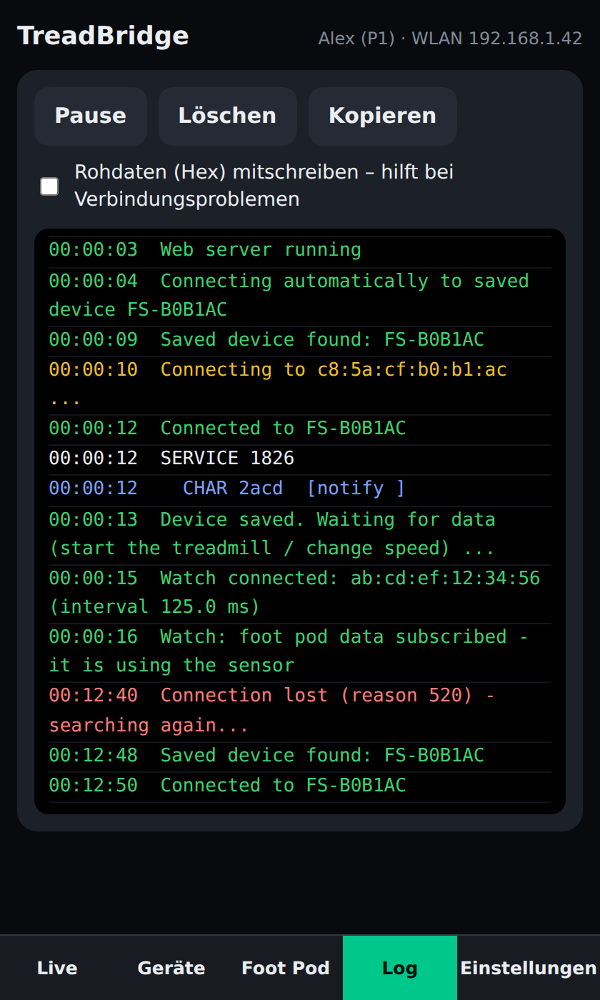
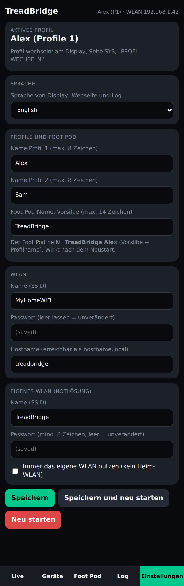

# TreadBridge

**Bring your treadmill data to your watch and your phone.**

An ESP32-C6 reads the live data of a Bluetooth treadmill (tested with the **Fitifito FT700**), shows it on a **touch display** (Waveshare ESP32-C6-Touch-LCD-1.47) and on a **web page**, and sends it to your **Garmin watch** as a Bluetooth *Foot Pod* (speed and distance for indoor runs, no GPS needed).

> **Compatibility:** TreadBridge was tested with the **Fitifito FT700** treadmill and the **Garmin Forerunner 970** only. It is not limited to these devices: any treadmill that offers the Bluetooth *Fitness Machine Service* (FTMS) and any watch that supports a Bluetooth foot pod (*Running Speed & Cadence*) should work as well. Wherever the FT700 or the Forerunner 970 is mentioned below, it is just the tested example.

> 🌐 **No tools needed:** install and configure the firmware straight from your browser with the **[TreadBridge Web Flasher](https://kashiyyy.github.io/TreadBridge/)** (Chrome / Edge on a desktop computer).

- Live **speed, pace, distance, incline and time** on the display and in any browser
- **Two profiles** (e.g. two runners in one household), each with its own Foot Pod name and Bluetooth address, so the right watch always finds the right sensor
- **Automatic reconnect** to your saved treadmill – also after the treadmill or the ESP32 was switched off and on again
- Display and web page in **English and German**
- Small **JSON API** (`/api/data`) for Home Assistant, scripts and dashboards
- **Web flasher** with a settings page: no code editing needed

```
 Treadmill ──Bluetooth (FTMS)──► ESP32-C6 ──Bluetooth (Foot Pod / RSC)──► Garmin watch
                                    │
                                    ├── touch display (live values, settings)
                                    └── WLAN ──► web page / JSON API
```

---

## Contents

1. [What you need](#what-you-need)
2. [Install](#install)
3. [First start: choose your profile](#first-start-choose-your-profile)
4. [Connect the treadmill](#connect-the-treadmill)
5. [Using the display](#using-the-display)
6. [Using the web interface](#using-the-web-interface)
7. [Garmin foot pod setup](#garmin-foot-pod-setup)
8. [Settings](#settings)
9. [JSON API](#json-api)
10. [Troubleshooting](#troubleshooting)
11. [Project structure](#project-structure)
12. [Changelog](#changelog)

---

## What you need

| Item | Notes |
|------|-------|
| **Waveshare ESP32-C6-Touch-LCD-1.47** | The board with the 1.47" touch display (172 × 320) |
| **USB-C data cable** | Charge-only cables will not work |
| **Bluetooth treadmill** | Must offer the *Fitness Machine Service* (FTMS) or *Running Speed & Cadence*. Tested: Fitifito FT700 (shows up as `FS-…`). Other treadmills with these services should work too |
| **Watch with Bluetooth foot pod support** | Tested with the Garmin Forerunner 970. Other watches that support a Bluetooth foot pod should work too (see [the note on compatibility](#garmin-foot-pod-setup)) |
| **2.4 GHz WLAN** | Optional but recommended, for the web page. Without it the ESP32 opens its own WLAN |

---

## Install

### Option A – Web flasher (easiest)

1. Open **<https://kashiyyy.github.io/TreadBridge/>** in **Google Chrome, Microsoft Edge or Opera** on a desktop computer.
2. Connect the board with USB-C.
3. Fill in your settings at the top of the page (WLAN name and password, profile names, language, hostname). Everything is optional and can be changed later.
4. Click **Install TreadBridge** and choose the serial port of the board.
5. When the installation is finished, the page **sends your settings to the device automatically** over USB. The device restarts and is ready – no second step needed. (If you untick *“Send my settings to the device right after installing”*, or if the automatic step does not start, use **Send settings to device** in step 3 of the page.)

You can come back to the page at any time to change settings only: connect the board, adjust the fields, click **Send settings to device**.

If no port shows up: hold **BOOT**, tap **RESET**, release **BOOT**, then try again.

> **Maintainer note – one-time setup:** in the GitHub repository open *Settings → Pages* and set **Source = GitHub Actions**. After that every push or merge to `main` builds the firmware (`.github/workflows/build.yml`), publishes the site and creates a **release** such as `v1.1.0-20261026-42` with the files `TreadBridge-v1.1.0-2026-10-26-complete.bin` (write to address `0x0`) and `…-app-only.bin`. The version comes from `FW_VERSION` in `src/defaults.h` – bump it by hand for a new version; date and build number are added automatically and show up in the firmware (USB `TB+PONG`, serial log) and in the web flasher.

### Option B – Build it yourself (PlatformIO)

1. Install **VS Code** and the **PlatformIO IDE** extension, then restart VS Code.
2. Clone this repository and open its folder (the one that contains `platformio.ini`) with *File → Open Folder…*.
3. Wait until the PlatformIO icons appear in the status bar. The first time PlatformIO downloads the platform, the Arduino core and the libraries (several hundred MB, takes a few minutes).
4. Copy `include/config.example.h` to `include/config.h` and enter `WIFI_SSID` and `WIFI_PASS` (2.4 GHz only). Everything else is optional – see [Settings](#settings).
5. Connect the board with USB-C, then click **Build** (checkmark) and **Upload** (arrow) in the status bar.

From a terminal: `pio run -t upload`

**If it does not work**

- *Platform not found / install error:* update PlatformIO Core (PlatformIO Home → Settings, or `pip install -U platformio`) and restart VS Code.
- *No port found:* try another USB cable (it must carry data). Force the upload mode: hold **BOOT**, tap **RESET**, release **BOOT**.
- *Serial monitor stays empty:* use the port labelled **USB** (not UART) on the ESP32-C6 and press **RESET** once.
- Anything else: open an issue and paste the text from the terminal window.

---

## First start: choose your profile

After power-up the display asks **“Who is running?”** and shows the two profile names. Tap your name – Bluetooth and the foot pod only start after that.

(The profile screen is the first picture in [Using the display](#using-the-display).)

- Each profile broadcasts its **own foot pod**, named `TreadBridge` + profile name (for example **“TreadBridge Alex”**), with its **own Bluetooth address**. The watch remembers a sensor by this address, so with one watch paired to “TreadBridge Alex” and another to “TreadBridge Sam”, the wrong watch never connects.
- **Stored per profile:** foot pod on/off, which values are sent to the watch, cadence.
- **Shared:** the treadmill (Bluetooth device), web server on/off, brightness.
- **Switch profile:** page **SYS** → **SWITCH PROFILE** (tap twice, the device restarts).
- **Rename profiles:** on the web page (*Settings*), in the web flasher, or in `include/config.h` (`PROFILE_NAME_1`, `PROFILE_NAME_2`, max. 8 characters). With `PROFILE_AUTOSTART_S` (for example `10`) the last used profile is chosen automatically after 10 seconds (default `0` = always wait).
- **Important for the first pairing:** pair only **one person at a time**, while their profile is active, so that two watches do not grab the same sensor.

---

## Connect the treadmill

1. Switch the treadmill on (console active). **Close nRF Connect / the FitShow app** on your phone first – the treadmill accepts only one Bluetooth connection.
2. On the display open page **DEVICE** and tap **SCAN** (or use **Scan for devices** on the web page).
3. Tap your treadmill (usually `FS-…`, tagged *Fitness*, shown in green at the top).
4. The device is saved. From now on the ESP32 **reconnects automatically** at startup and after every connection loss.

**Disconnect** pauses the auto-connect until you connect again (or restart). **Forget** deletes the saved treadmill.

---

## Using the display

The 1.47" display (172 × 320, portrait, USB socket at the bottom) has four pages. **Swipe left/right** to change pages (left = next page, right = previous; after SYS comes LIVE again). The bar at the bottom shows where you are; tapping it works too. On all pages except LIVE the header shows the status of treadmill and watch and the active profile (“P1”/“P2”).

<p align="center"></p>

| Page | Content |
|------|---------|
| **LIVE** | Two indicators, **TREADMILL** and **WATCH** (green = connected/sending, yellow = searching/waiting, red = disconnected, grey = foot pod off). Below: the **speed in big digits** with “km/h”, plus pace, distance, time (hh:mm:ss) and incline. In landscape, time and incline sit in one row |
| **DEVICE** | **SCAN** starts the Bluetooth scan, tap a device to connect it as treadmill (fitness devices are on top, in green), **DISC.** disconnects. Long names are shortened. Scroll by swiping up/down or with **UP/DOWN** |
| **FOOT** | Foot pod on/off, which values are sent to the watch (cadence, stride length, distance, running/walking), cadence with **-/+** (auto = estimated from the speed), test speed with **-/+** |
| **SYS** | Brightness, auto-connect, **web server on/off**, **landscape** mode, forget device (tap twice), switch profile (tap twice), WLAN address and system info |

**Web server off** switches off the web server **and** WLAN. That frees the radio and can make Bluetooth / the foot pod more stable. The setting survives a restart.

**Landscape view:** on page SYS toggle **Landscape**. Every page has its own landscape layout and the setting is stored. If the picture is upside down, change `LANDSCAPE_ROT` from `1` to `3` in `include/pins.h`.

<p align="center"></p>

**Touch mirrored or swapped?** Change `TOUCH_FLIP_X`, `TOUCH_FLIP_Y`, `TOUCH_SWAP_XY` (0/1) in `include/pins.h`. Umlauts (ä ö ü ß) are supported, also in profile names; other special characters appear as “?”.

*The display pictures are rendered from the real `src/ui.cpp` with demo values – regenerate them with `tools/display-preview/build.sh` after changing the UI.*

---

## Using the web interface

Open **`http://treadbridge.local`** (default hostname) in a browser on a phone or PC in the same WLAN. If the name does not work, use the IP address shown on the display (page SYS), printed once in the serial monitor (115200 baud) at startup, or listed in your router.

If the WLAN does not work, the ESP32 opens its own WLAN **TreadBridge** (password `treadbridge123`); the page is then at **`http://192.168.4.1`**.

The look follows the display. The bar at the bottom selects the page:

<table>
<tr>
<td align="center"><b>Live</b><br></td>
<td align="center"><b>Devices</b><br></td>
<td align="center"><b>Foot pod</b><br></td>
</tr>
<tr>
<td align="center"><b>Log</b><br></td>
<td align="center"><b>Settings</b><br></td>
<td></td>
</tr>
</table>

*(Screenshots show demo data.)*

| Page | Content |
|------|---------|
| **Live** | Indicators for treadmill and watch (foot pod), speed in big digits, pace, distance, time (hh:mm:ss), incline |
| **Devices** | **Scan for devices**, then **Connect** next to your treadmill. At the top you see the registered treadmill with **Disconnect** and **Forget**. The saved treadmill reconnects automatically at startup and after a connection loss (for example when the treadmill was switched off and on). After **Disconnect** the auto-connect stays off until you connect again |
| **Foot pod** | Foot pod on/off, which values go to the watch, cadence, test speed |
| **Log** | Readable, colour-coded log (red = error, green = success, yellow = activity), pause, clear, copy. **Raw data** additionally logs hex packets |
| **Settings** | **Language (German/English)**, profile names, foot pod name, WLAN, hostname, own WLAN, restart |

**Language:** choose **Deutsch** or **English** under *Settings*. It applies immediately to display, web page and log and is stored. Default on the very first start: `DEFAULT_LANG` in `src/defaults.h` (`1` = English, the default; `0` = German). Profile names and the foot pod name are proper names and are not translated.

**Settings:** everything you change there is stored in flash and overrides the values from `config.h`. Profile names and language apply immediately; WLAN, hostname and foot pod name apply after a restart (“Save and restart”). After a restart you have to choose a profile on the display again. An empty password field means “unchanged”. If the WLAN does not work after a change, the device opens its own WLAN after 15 seconds (default `TreadBridge`).

> The web page has **no password protection** – use it only in your home network.

---

## Garmin foot pod setup

The ESP32-C6 forwards the treadmill data as a Bluetooth foot pod (service `0x1814`), called **“TreadBridge <profile name>”**. The watch then gets speed and distance directly from the treadmill.

- **Speed:** from the treadmill (FTMS). If the treadmill sends nothing for more than 5 s, the speed drops to 0.
- **Distance:** the treadmill’s distance, otherwise calculated from the speed. Sent as total distance in the foot pod packet.
- **Cadence:** treadmills do not report cadence. It is estimated from the speed (about 150 steps/min at 7 km/h, about 165 at 10 km/h) or set to a fixed value (web page or `CADENCE_MANUAL`). The stride length is derived from speed and cadence so both fit together.
- **Running/walking:** from 7 km/h “running” is reported, below that “walking”.

**Which values are sent to the watch?** On the web page (card *Foot pod*, “Sent to the watch”) or on the display (page FOOT): **speed** is always sent; **cadence, stride length, distance** and **running/walking** can be switched on individually. The choice is stored. The default is speed only (`FP_DEFAULT_MASK` in `config.h`). Values that are not sent are simply missing from the packet; only the cadence field is mandatory and is then sent as 0.

**Set up the watch (tested: Garmin Forerunner 970):**

1. Make sure the foot pod is on (default) and the treadmill is connected.
2. On the watch go to *Sensors & Accessories*, add a new sensor of type **Foot Pod** and select **TreadBridge <your profile name>**. Menu names can differ between watch models and firmware versions.
3. In the treadmill activity use the foot pod for speed/distance (instead of GPS/estimation).

**Test without a treadmill:** enter a test speed (for example 8.0 km/h) on the web page (or on page FOOT). The ESP32 then sends this speed to the watch, so you can check whether the watch finds and uses the sensor.

**Please note:** ANT+ is **not possible** with the ESP32-C6. Any watch that supports a *Bluetooth* foot pod should be able to use TreadBridge, but whether a particular model accepts it as speed source depends on the watch – the test mode shows it quickly. If it does not, ANT+ (a sensor or an ANT+ USB stick) remains.

---

## Settings

### Build-time options (`include/config.h`)

Copy `include/config.example.h` to `include/config.h` (it is git-ignored, so your WLAN password never gets committed).

| Option | Meaning |
|--------|---------|
| `WIFI_SSID`, `WIFI_PASS` | your WLAN (2.4 GHz) |
| `HOSTNAME` | name for `http://<name>.local` |
| `AUTO_CONNECT` | connect to the saved device automatically |
| `TARGET_NAME` | optional name prefix (e.g. `FS-`) for auto-connect without a saved device |
| `FORCE_AP` | `true` = always use the own WLAN instead of the home WLAN (e.g. at a treadmill without a router) |
| `AP_SSID`, `AP_PASS` | name and password of the own WLAN (password ≥ 8 characters) |
| `FOOTPOD_NAME`, `FOOTPOD_AUTOSTART` | name of the foot pod on the watch, start at power-up |
| `CADENCE_MANUAL` | `0` = automatic cadence, otherwise a fixed value |
| `FP_DEFAULT_MASK` | values sent to the watch besides speed (bit0 cadence, bit1 stride, bit2 distance, bit3 running/walking) |
| `WIFI_LEGACY`, `COEX_PREFER_WIFI` | radio coexistence tuning, see [Troubleshooting](#troubleshooting) |
| `SERIAL_LOG` | `true` = also print messages to the serial monitor (debug) |
| `RAW_LOG` | `true` = log all raw packets |

Further defaults (profile names, automatic-reconnect timing, default language) live in `src/defaults.h` and can be overridden in `config.h`.

### Runtime settings (no recompiling)

WLAN, hostname, profile names, foot pod name and language can be changed on the web page (*Settings*) or with the **web flasher** (over USB). Values saved this way override `config.h`.

---

## JSON API

`GET http://treadbridge.local/api/data` returns JSON, for example:

```json
{"connected":true,"device":"FS-B0B1AC","speed_kmh":8.00,"pace_s_per_km":450,
 "distance_m":1234,"incline_pct":1.0,"heart_rate":null,"energy_kcal":62,
 "elapsed_s":555,"age_ms":420}
```

Values the treadmill does not provide are `null`. `age_ms` is the age of the last packet. The interface allows requests from other web pages (CORS), so it works well with Home Assistant, scripts or your own dashboards.

### USB serial protocol (used by the web flasher)

The firmware understands single-line commands over USB (115200 baud):

| Command | Answer |
|---------|--------|
| `TB+PING` | `TB+PONG <firmware version>` |
| `TB+GET` | `TB+CFG {json}` (passwords are never sent back) |
| `TB+SET key=value&key=value` | `TB+OK {"restart":true}` or `TB+ERR <message>` (values percent-encoded; keys: `wssid wpass host apssid appass forceap pn1 pn2 fpbase lang`) |
| `TB+RESTART` | restarts the device |

---

## Troubleshooting

- **The treadmill does not reconnect after it (or the ESP32) was restarted.** Fixed in version 1.1.0, see the [changelog](#changelog). Make sure the phone app (FitShow / nRF Connect) is closed, because the treadmill accepts only one connection. The saved treadmill is searched every few seconds; the log shows *“Saved device not found yet - still searching”* while it is switched off.
- **No values arrive.** Start the treadmill – many devices only send data while the belt is running.
- **Web page slow once the watch is connected?** The ESP32-C6 shares one radio between WLAN and Bluetooth. The project therefore uses an asynchronous web server, long Bluetooth connection intervals (100–200 ms), no WiFi 6 and gives WLAN priority on conflicts (`WIFI_LEGACY`, `COEX_PREFER_WIFI`). If the watch connection drops more often because of that, set `COEX_PREFER_WIFI = false`. A restart of the ESP32 or `FORCE_AP = true` (direct connection to the ESP32 without a router) often helps as well.
- **Debug log.** The page only shows the **last status message** under the status line. The *Log* page has the full history; with `SERIAL_LOG = true` (and `RAW_LOG = true` for raw packets) the serial monitor shows it too.
- **Wrong WLAN data.** Connect to the WLAN `TreadBridge` (password `treadbridge123`), open `http://192.168.4.1` and correct the settings.

---

## Project structure

```
TreadBridge/
├── platformio.ini
├── include/
│   ├── config.example.h   build-time settings (copy to config.h)
│   └── pins.h             pins of the Waveshare board, touch orientation
├── src/
│   ├── main.cpp           Bluetooth (read treadmill, send foot pod), web server, serial provisioning
│   ├── app.h              interface between application and display
│   ├── defaults.h         default values (profile names, reconnect timing, version) - can be overridden in config.h
│   ├── webpage.h          web interface (HTML, CSS, JavaScript)
│   ├── ui.cpp             display UI
│   └── touch.cpp/.h       driver for the AXS5106L touch controller
├── tools/display-preview/ renders the display UI on a PC (creates the README pictures)
├── docs/                  web flasher (GitHub Pages) and README images
│   ├── index.html
│   ├── manifest.json
│   └── images/
└── .github/workflows/build.yml   builds the firmware on every push to main, creates a release, deploys the web flasher
```

---

## Changelog

### 1.1.1
- **Changed:** landscape LIVE page. The *Incline %* box is now as big as *Pace* and *Distance* and sits below them in the right column; the *Time* box is wider instead. The *Treadmill* and *Watch* boxes at the top are equally wide, and the right one ends flush with the right column.
- **Changed:** landscape DEVICE page. *SCAN*, *DISC.*, *UP* and *DOWN* are equally wide with equal gaps and end flush with the right edge of the Bluetooth name list. In portrait the two top buttons now end flush with the list as well.
- **Changed:** README screenshots regenerated with `tools/display-preview/make_images.py`.

### 1.1.0
- **Fixed:** automatic reconnect. After the treadmill or the ESP32 was restarted, the display showed “searching” but never connected; you had to press *Connect* manually. Cause: in NimBLE-Arduino 2.x, stopping a scan does not call the scan-end callback, so the “connect now” step never ran and the scan state stayed stuck. The BLE task now handles the hit itself and keeps the scan state in sync with the real scanner.
- **New:** web flasher with settings page (GitHub Pages) and serial provisioning commands.
- **New:** `include/config.example.h`.
- **New:** every push to `main` builds the firmware and creates a release with version number and date.
- All code comments and the documentation are now in English.